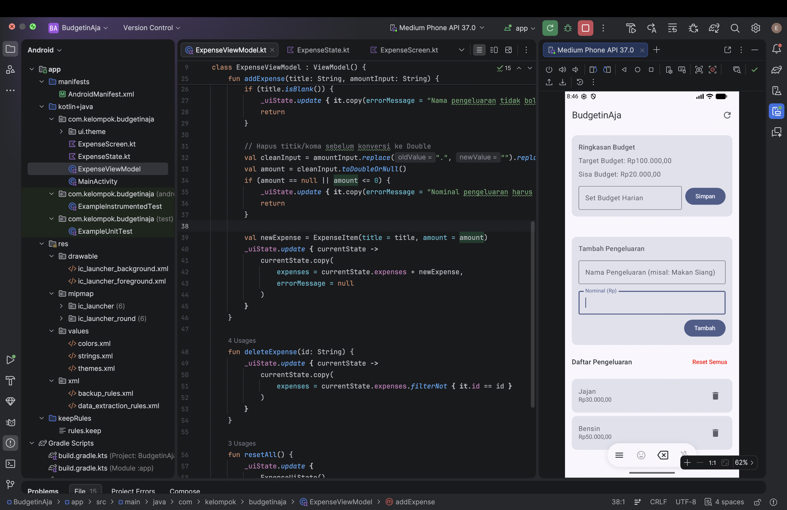
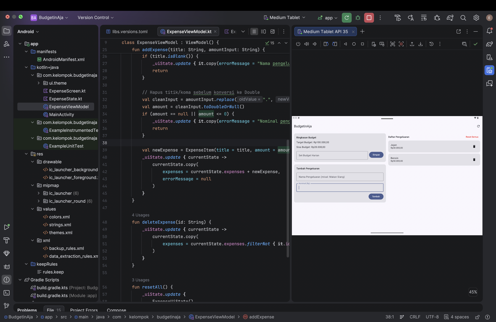

# BudgetinAja 💰

Aplikasi manajemen keuangan dan pencatatan pengeluaran harian berbasis Android yang dibangun menggunakan **Jetpack Compose**, **StateFlow**, dan pola arsitektur **Unidirectional Data Flow (UDF)**.

Tugas Kelompok Pengembangan Aplikasi Bergerak: Aplikasi compose sederhana UI/UX, MVVM, dan UI State — Universitas Islam Indonesia.

---

## 👥 Anggota Kelompok

| Nama | NIM | Kontribusi |
|------|-----|------------|
| **Hilmy Andrian Saputra** | 24523014 | UiState (`ExpenseUiState`), ViewModel (`ExpenseViewModel`), pengelolaan `StateFlow` |
| **Naufal Ahmad Fauzi** | 24523168 | Layout adaptif (`isWideScreen`), komponen UI (`ExpenseScreen`, `BudgetAndFormSection`, `ExpenseListSection`) |
| **Eka Septy Pricilia** | 24523221 | Validasi input, pemformatan angka (`ThousandSeparatorVisualTransformation`), dokumentasi `README.md` |

---

## 📌 Deskripsi Proyek

### 🔴 Masalah (Problem)
Banyak orang kesulitan melacak pengeluaran harian mereka secara real-time. Tanpa target budget harian yang jelas, seseorang sering kali tidak menyadari bahwa pengeluaran mereka telah melebihi batas finansial harian yang direncanakan.

### 🎯 Pengguna (Target User)
* Mahasiswa dan pekerja muda yang ingin mengontrol pengeluaran harian.
* Pengguna yang membutuhkan aplikasi pencatatan keuangan yang cepat, praktis, responsif, dan mudah digunakan.

### 💡 Solusi (Solution)
**BudgetinAja** memberikan solusi pencatatan finansial ringkas di mana pengguna dapat menetapkan target budget harian, mencatat setiap transaksi pengeluaran, dan secara otomatis melihat kalkulasi sisa budget harian yang diperbarui secara real-time.

---

## ✨ Fitur Utama & Kondisi UI

1. **Target Budget Harian**: Mengatur jumlah budget harian (`dailyBudget`).
2. **Kalkulasi Sisa Budget Real-Time**: Sisa budget dihitung secara otomatis (`remainingBudget = dailyBudget - totalExpenses`) dan berubah warna menjadi merah jika pengeluaran membengkak (minus).
3. **Pencatatan Pengeluaran**: Menambahkan nama dan nominal pengeluaran dengan pemisah ribuan otomatis (`ThousandSeparatorVisualTransformation` & Format Rupiah IDR).
4. **Hapus & Reset Data**: Menghapus item pengeluaran tertentu (`deleteExpense`) atau mereset seluruh data (`resetAll`) dengan konfirmasi dialog aman (`AlertDialog`).
5. **Layout Adaptif (Multi-Window / Multi-Size)**: Tampilan menyesuaikan secara responsif untuk layar HP (Portrait) dan Layar Lebar/Tablet (Landscape/Wide Screen $\ge$ 600dp).
6. **Penanganan Error Validasi**: Menampilkan pesan peringatan `Snackbar` jika input tidak valid.

### 📱 Kondisi Tampilan UI
| Kondisi | Tampilan UI |
|---------|-------------|
| **Data Kosong** | Teks *"Belum ada pengeluaran dicatat."* |
| **Data Tersedia** | Daftar kartu pengeluaran (`LazyColumn`) dengan tombol hapus |
| **Validasi Gagal** | `Snackbar` berisi pesan kesalahan dengan tombol OK untuk menutup |

### ⚠️ Pesan Validasi
* `"Budget harus berupa angka positif!"`
* `"Nama pengeluaran tidak boleh kosong!"`
* `"Nominal pengeluaran harus berupa angka valid!"`

---

## 🏛️ Arsitektur (MVVM)

```
app/src/main/java/com/kelompok/budgetinaja/
├── MainActivity.kt        # Titik masuk utama aplikasi (Activity), memanggil ExpenseScreen()
├── ExpenseState.kt        # MODEL (ExpenseItem) & UI STATE (ExpenseUiState)
├── ExpenseViewModel.kt    # VIEWMODEL: logika bisnis & MutableStateFlow
├── ExpenseScreen.kt       # VIEW: Composable screen, komponen UI, & VisualTransformation
└── ui/theme/              # Tema Material 3 (Color.kt, Type.kt, Theme.kt)
```

### Pembagian Tanggung Jawab Lapisan:
| Lapisan | File / Component | Tanggung Jawab |
|---------|------------------|----------------|
| **Model** | `ExpenseItem` | Data class satu item pengeluaran: `id`, `title`, `amount` |
| **UI State** | `ExpenseUiState` | Data class immutable berisi `dailyBudget`, `expenses`, `errorMessage`, dan properti kalkulasi `remainingBudget` |
| **ViewModel** | `ExpenseViewModel` | Memegang logika bisnis & validasi: `setDailyBudget`, `addExpense`, `deleteExpense`, `resetAll`, `clearError` |
| **View** | `ExpenseScreen` | Menampilkan UI berdasarkan state dan meneruskan aksi/event pengguna ke ViewModel |

---

## 🔄 Contoh Alur Unidirectional Data Flow (UDF)

Aplikasi ini menerapkan pola **UDF (Unidirectional Data Flow)** dengan Jetpack Compose & `StateFlow`:

```
          +-------------------------------------------------+
          |                                                 |
          v                                                 |
  +---------------+        Event         +------------------+--+
  |  UI (Compose) | -------------------> | ExpenseViewModel    |
  +---------------+  (e.g. addExpense)   +------------------+--+
          ^                                                 |
          |               State                             |
          +-------------------------------------------------+
                  (e.g. ExpenseUiState)
```

### Penjelasan Alur UDF pada Fitur "Tambah Pengeluaran":
1. **User Event**: Pengguna menginput nama pengeluaran & nominal, lalu menekan tombol **Tambah**. UI memanggil fungsi `viewModel.addExpense(titleInput, amountInput)`.
2. **State Processing**: `ExpenseViewModel` menerima input, membersihkan karakter pemisah (`replace(".", "")`), memvalidasi bahwa nominal $> 0$ dan nama tidak kosong, lalu memperbarui `_uiState` (`MutableStateFlow`) secara immutable menggunakan `_uiState.update { ... }`.
3. **State Emitted**: Objek `ExpenseUiState` baru dipancarkan melalui `StateFlow`.
4. **UI Render**: Composables (`ExpenseScreen`, `BudgetAndFormSection`, `ExpenseListSection`) yang meng-observe state melalui `collectAsStateWithLifecycle()` menerima state terbaru dan merender ulang tampilan (Sisa Budget & Daftar Pengeluaran) secara otomatis.

---

## 📸 Screenshot Aplikasi

| Layar HP / Standar (< 600dp) | Layar Lebar / Tablet (>= 600dp) |
|:---:|:---:|
|  |  |

---

## 🚀 Cara Menjalankan Proyek

1. **Clone Repository**:
   ```bash
   git clone https://github.com/ekaprclia/PAB-BudgetinAja.git
   cd PAB-BudgetinAja
   ```
2. **Buka di Android Studio**:
   * Buka Android Studio (versi Hedgehog 2023.1.1 atau yang lebih baru).
   * Pilih **Open** dan arahkan ke folder proyek **BudgetinAja**.
3. **Jalankan via Android Studio / Gradle Wrapper**:
   * Jalankan langsung di Emulator / Perangkat Fisik via tombol **Run** (`Shift + F10`).
   * Atau melalui terminal:
     ```bash
     ./gradlew assembleDebug
     ```

---

## 📚 Referensi

Konsep dalam proyek ini dipelajari dari dokumentasi resmi Android Developers dan diimplementasikan sesuai kebutuhan proyek:

* [Android Developers - UI Layer & UDF](https://developer.android.com/topic/architecture/ui-layer)
* [Android Developers - State & Jetpack Compose](https://developer.android.com/develop/ui/compose/state)
* [Android Developers - Adaptive Layouts in Compose](https://developer.android.com/develop/ui/compose/layouts/adaptive)
